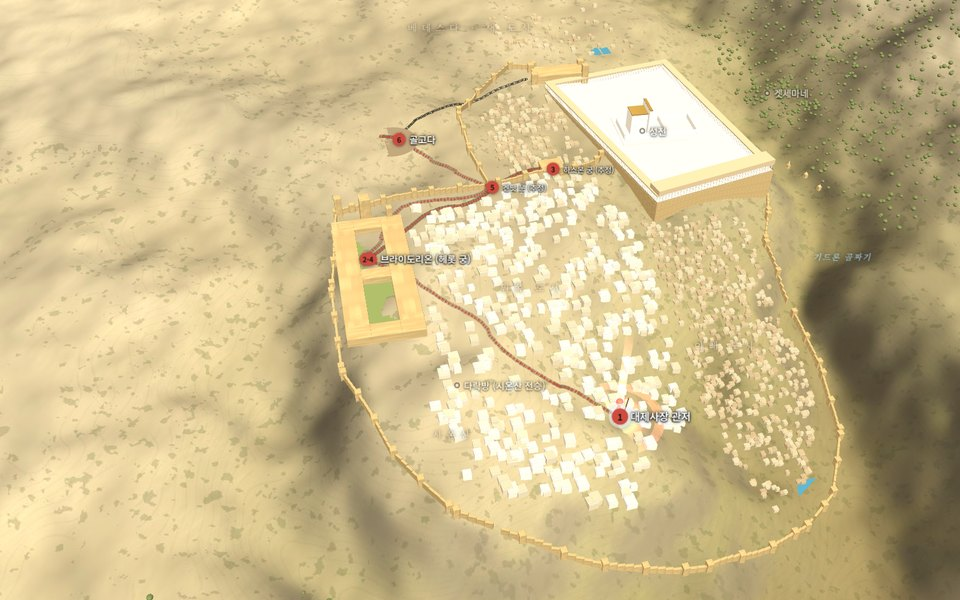

# 예수님의 길 · 3D 지도

예수님의 탄생과 피난, 열두 살의 유월절, 예루살렘으로 올라가는 길, 그리고 **마지막 일주일**을 실제 지형과 **주후 30년 무렵 예루살렘 3D 복원** 위에서 따라가는 장유중앙교회 교육용 웹앱입니다. 당시의 정치·경제·서민의 삶을 함께 볼 수 있습니다. 「3D로 보는 성경」 모음에 들어가는 공간입니다.

- 주소: https://jangyu-church.github.io/jesus/
- 바로 열기: `#birth` 탄생과 피난 · `#boy` 열두 살 · `#ascent` 마지막 길 · `#d1`–`#d8` 일요일~부활 · `#life` 그때의 삶



## 세 가지 보기

| 보기 | 내용 |
|---|---|
| **탄생과 어린 시절** | 갈릴리~이집트 실제 지형. 탄생과 피난(9곳), 열두 살의 유월절(6곳), 예루살렘으로 올라가는 길(4곳). **정치 지도**(주전 4년 분할 ↔ 주후 30년)와 사회상 핀 |
| **마지막 일주일** | 1세기 예루살렘 3D 복원(성전산·성전·왕의 주랑·안토니아·헤롯 궁과 세 탑·제1·제2성벽과 성문·집 천여 채·실로암과 베데스다·기드론 무덤·감람산 올리브 숲). 일요일~부활의 아침 8일, 성벽은 성문으로만 드나들게 계산한 동선. 중세 전통 ‘십자가의 길’ 비교 |
| **그때의 삶** | 통치자 연표, 성경 속 화폐 9종과 물가 15가지(오늘 품삯으로 환산), 사회 계층·세금·집·혼인·음식·정결·절기·로마의 질서 |

해설마다 근거를 **본문 · 고고학 · 전승 · 학설 · 논쟁** 꼬리표로 구분했습니다.

## 파일 구성

| 파일 | 하는 일 |
|---|---|
| `data.js` | **장소·여정·해설·사회상 자료** — 글을 고치려면 이 파일만 고치면 됩니다 |
| `city.js` | 1세기 예루살렘 평면 (성전산 윤곽, 성벽, 성문, 건물, 구역) |
| `engine.js` | **3D 지형 지도 엔진** — 지역 지도(수백 km)와 도시 지도(수 km)를 같은 방식으로 다룸. 다음 지도 앱에 그대로 재사용 |
| `decor.js` | 지도별 3D 장식 (예루살렘 복원 모형, 마을 모형) |
| `app.js` · `index.html` · `style.css` | 화면 |
| `data/land`, `data/jeru` | 지형 그림·높이·바다 자료, `data/routes.json` 계산된 경로 |
| `tools/` | 지형·경로를 다시 만드는 도구 |

## 지형·경로를 다시 만들 때

```bash
python3 tools/fetch_tiles.py land 10 29.5 36.0 29.6 33.2
python3 tools/fetch_tiles.py jeru 15 35.212 35.272 31.758 31.795
python3 tools/bake.py land && python3 tools/bake.py jeru
python3 tools/route.py
```
(numpy · pillow · scipy · node 필요. 해설 글만 고칠 때는 필요 없습니다.)

## 자료 기준

- 본문: 마 1–2, 19–28장 · 막 10–16장 · 눅 1–2, 9, 18–24장 · 요 11–20장. 지명·인용은 개역개정.
- 연구: 교회 제공 연구 정리 두 편(탄생 전후 동선, 수난주간 동선의 사회·고고학 분석)을 바탕으로 요세푸스·필론·미쉬나와 발굴 보고를 더함.
- 3D 모형: 성전산 윤곽은 OpenStreetMap(ODbL), 성전 치수는 미쉬나 「미돗」·요세푸스, 성벽·성문은 추정선. 집과 나무는 밀도를 보여 주는 배치입니다.
- 지형: Terrain Tiles (Mapzen/AWS Open Data — SRTM, GMTED, ETOPO1 등). 3D 표시: three.js (MIT).
